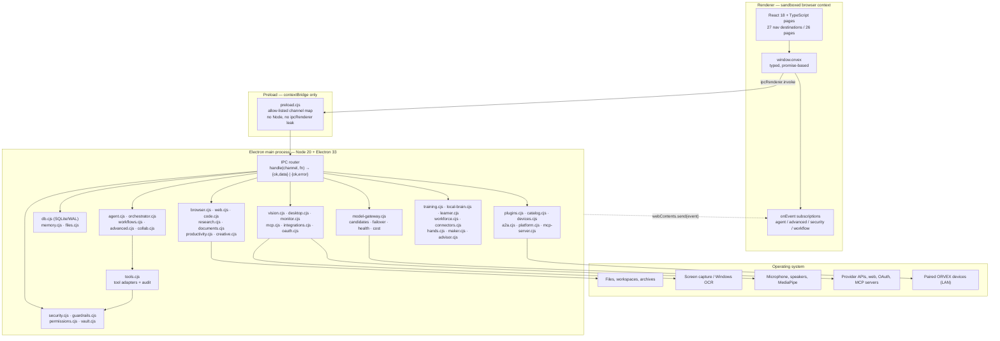
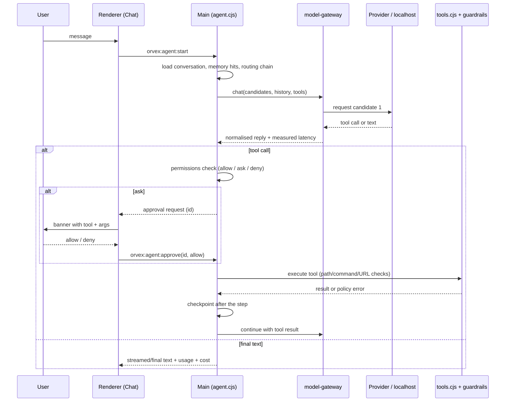
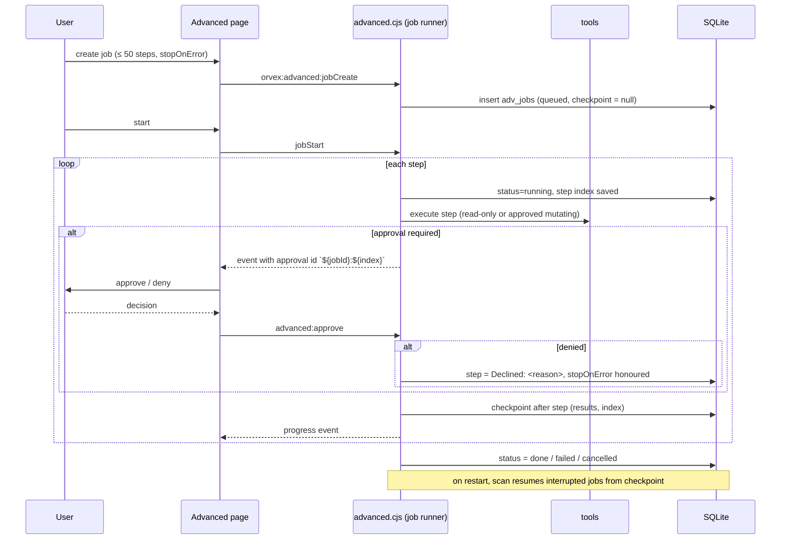
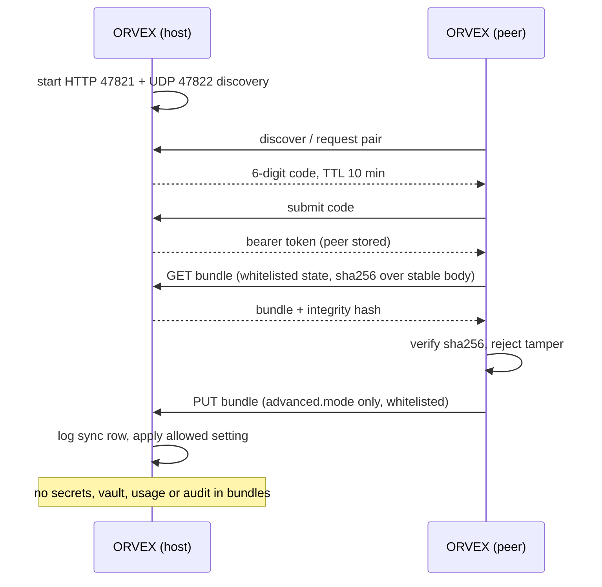

# ORVEX — Architecture and References (Section 22)

This document describes how ORVEX is put together at runtime: the process model, the IPC contract between the renderer and the main process, the storage layout per profile, the security boundaries that every capability crosses, the concrete data flows for the six privileged paths, and the upstream specifications the implementation follows.

It is written against the code in `electron/` and `src/` on 2026-11-02 and matches the verified test ledger in [21-roadmap.md](21-roadmap.md).

---

## 1. System diagram

### 1.1 Mermaid — processes, modules and boundaries



### 1.2 ASCII — same picture without a renderer

```
┌───────────────────────────── Electron host ─────────────────────────────┐
│                                                                          │
│  ┌──────────── Renderer (sandbox, no Node) ────────────┐                 │
│  │ React pages ── window.orvex ── event subscriptions  │                 │
│  └───────────────────────┬─────────────────────────────┘                 │
│                          │ contextBridge (preload.cjs)                   │
│                          │ invoke(channel) / on(event)                   │
│  ┌───────────────────────▼─────────────────────────────┐                 │
│  │ Main process — IPC router, one handler per channel  │                 │
│  │  security ─ guardrails ─ permissions ─ vault        │                 │
│  │  agent / orchestrator / workflows / advanced /      │                 │
│  │  collab  ──► tools ──► audit                        │                 │
│  │  model-gateway ──► provider / localhost endpoints   │                 │
│  │  db (SQLite WAL) · memory (FTS5) · files            │                 │
│  │  code · research · documents · productivity         │                 │
│  │  vision · desktop · monitor · integrations · mcp    │                 │
│  │  plugins (sandboxed child) · devices (LAN server)   │                 │
│  └───────┬───────────────────┬──────────────────┬──────┘                 │
│          │                   │                  │                        │
│   userData profile      OS services        provider / LAN / MCP          │
│   orvex.db, assets,     capture, OCR,      HTTPS fetch, OAuth,           │
│   prefs, secrets,       audio, DPAPI       UDP 47822, HTTP 47821,        │
│   audit.jsonl           (safeStorage)      MCP stdio/HTTP                 │
└──────────────────────────────────────────────────────────────────────────┘
```

### 1.3 Diagram rules enforced by the code

- The renderer never receives `ipcRenderer`, `require`, `fs` or `process`; only the hand-built `window.orvex` object.
- Every main-process capability is a named channel returning `{ ok, data }` or `{ ok, error }`; no handler throws across the bridge.
- Events flow one way only: `webContents.send` to renderer subscribers, never the reverse.
- A capability that needs a native resource (screen, clipboard, DPAPI, child process) lives in the main process; the renderer only asks.

---

## 2. Process model

| Process | Lifetime | Privileges | Responsibility |
| --- | --- | --- | --- |
| Main | App lifetime | Full Node + Electron APIs | Windows, IPC, state, tools, providers, cron, LAN server, plugin supervisor |
| Renderer | Window lifetime | Browser only, sandboxed | UI, local view state, MediaPipe/Speech APIs explicitly granted |
| Plugin host | Per plugin session | Node permission model: read plugin folder + host folder, write data folder; no child processes, workers or addons | Runs third-party tool code in isolation |
| Utility / hidden windows | Per feature | Renderer privileges | Media capture, recorder page |
| External browser | On demand | User's own browser | Playwright automation via CDP-launched Chromium |

Single instance is enforced with `requestSingleInstanceLock`; a second launch focuses the existing window. Tray, global shortcuts and close-to-tray are main-process concerns. Quit cleanup stops cron, device server, plugin hosts, MCP transports and closes the database.

Renderer hardening: `contextIsolation: true`, `nodeIntegration: false`, `sandbox: true` for both the main and mini windows (MediaPipe/WebAssembly run inside the sandbox); navigation and window-open handlers are denied except for allow-listed URLs.

---

## 3. IPC contract

### 3.1 Shape

```
renderer:  await window.orvex.<namespace>.<method>(args)
preload:   invoke('orvex:<namespace>:<action>', args)
main:      handle('orvex:<namespace>:<action>', fn)
success:   { ok: true,  data: <JSON-serialisable> }
failure:   { ok: false, error: '<human-readable message>' }
```

`handle()` wraps every handler so an exception becomes `{ ok: false, error }`; handlers never leak stack traces or secret values. Payloads are validated at the boundary (type, range, enum, path policy) and rejected with a specific message.

### 3.2 Namespaces exposed by `preload.cjs`

`env`, `tool`, `agent`, `orchestrator`, `app`, `prefs`, `window`, `audit`, `llm`, `providers`, `stt`, `mcp`, `mcpServer`, `dashboard`, `monitor`, `security`, `secrets`, `permissions`, `db`, `files`, `memory`, `research`, `documents`, `creative`/`media`, `code`, `browser`, `web`, `workflows`, `integrations`, `connectors`, `oauth`, `tools`, `productivity`, `usage`, `routing`, `budget`, `advisor`, `health`, `desktop`, `hands`, `air`, `advanced`, `training`, `localBrain`, `learner`, `workforce`, `maker`, plus `isDesktop`.

The `advanced` namespace (Section 19) covers modes/status/context/suggestions/approvals, rules CRUD + tick, self-eval + history, route stats/recommend/apply, learning list/mine/approve/dismiss, jobs CRUD/start/pause/resume/cancel/delete, recovery scan/resume/discard, collaboration, vision, plugins/marketplace and devices/sync. It also exposes `onEvent` for `orvex:advanced:event`.

### 3.3 Event channels

| Channel | Producer | Consumers |
| --- | --- | --- |
| `orvex:agent:event` | agent loop | Chat, Agents, Shell badges |
| `orvex:advanced:event` | jobs, rules, collab, plugins, devices | Advanced page, toasts |
| `orvex:security:changed` | security policy | Security page, lock screen |
| `orvex:workflow:event` | workflow runner | Automation page |
| `orvex:orchestrator:event` | orchestrator | Engine page |
| `orvex:monitor:event` | monitor sampler | Dashboard, Monitoring |

Each subscription returns an unsubscribe function so pages do not accumulate listeners across mounts.

### 3.4 Validation checklist applied at the boundary

1. Required fields present and of the right type.
2. Enumerations constrained (`mode`, `status`, `task`, `role`).
3. Limits clamped (job steps 50, collab agents 5, rounds 3, context 30, limits 40).
4. Paths resolved and passed through `guardrails.checkPath` before any fs call.
5. Tool names resolved against the live registry, never trusted strings.
6. Secrets read only inside the vault/gateway boundary; never returned or logged.

---

## 4. Storage map (one profile)

Profile root is `app.getPath('userData')`, overridable with `ORVEX_USER_DATA_DIR` for tests. The portable build sets it to `ORVEX-data` next to the executable (Electron's `PORTABLE_EXECUTABLE_DIR`) so the profile travels with the app.

| Path | Format | Contents | Written by |
| --- | --- | --- | --- |
| `orvex.db` | SQLite, WAL | Settings, usage, routing, conversations, messages, memory items, runs + steps, workflows, jobs, tasks, audit rows, assets, prompts, evals, metrics, crash rows, all `adv_*` tables | `db.cjs` and feature modules |
| `secrets.json` | safeStorage-encrypted blob | Provider keys, OAuth tokens, connector credentials | `vault.cjs` only |
| `prefs.json` | JSON | Close-to-tray, theme, wake word, UI preferences | `main.cjs` |
| `audit.jsonl` | JSON Lines | Append-only tool/agent/security trail | `tools.cjs` |
| `memory.md` | Markdown | Human-readable long-term notes mirrored with memory records | `tools.cjs` / memory |
| `assets/`, `media/`, `research/`, `backups/` | Files | Generated media, research reports, backups | creative/research/security |
| `plugins/<id>/`, `plugin-data/<id>/` | Code + files | Installed plugin code and its writable data | plugin supervisor |
| Chromium cache, Local Storage | Browser-managed | Window state, renderer storage | Electron |

Database rules: WAL, single writer, prepared statements, JSON columns for flexible specs, schema created with `CREATE TABLE IF NOT EXISTS`, migrations idempotent. The renderer never opens the file; every read or write is an IPC call.

---

## 5. Security boundaries

Six boundaries are enforced in depth, not documented as intent:

1. **Renderer boundary** — context isolation, no Node, allow-listed bridge, no navigation to arbitrary origins.
2. **Path boundary** — `guardrails.checkPath` blocks system folders, credential stores, private keys, whole drives and traversal; every fs, archive, document, OCR and media path passes it.
3. **Process boundary** — plugin hosts run under `--experimental-permission` with only the plugin folder (read), the host folder (read) and the plugin data folder (write). `child_process`, `worker_threads` and native addons are denied by policy; a denial surfaces as a real error, and the install still completes only if the manifest is valid.
4. **Secret boundary** — keys live only in the vault/gateway; the renderer receives presence flags, never values; audit rows, device bundles, backups and error strings are scrubbed.
5. **Approval boundary** — mutating or sensitive tools require an explicit allow per occurrence. Agent approvals and autonomous-job approvals use separate id spaces; a denial is final for that step and is recorded.
6. **Network boundary** — guardrails URL policy for tools and fetch; device sync is LAN-only; MCP servers are user-configured; plugin network access is documented as unrestricted and surfaced in the UI instead of being silently trusted.

At-rest protection uses Electron `safeStorage` (Windows DPAPI). Optional PIN lock uses scrypt with per-attempt delay and escalating lockout; emergency stop halts agents, workflows, jobs, cron and device server in one action.

---

## 6. Data flows

### 6.1 Chat / agent run with tool approvals



Failover is observable: each call records success/failure and latency; the breaker demotes unhealthy candidates; routing advice is computed from those measured outcomes, not from heuristics presented as data.

### 6.2 Autonomous job (Section 19)



Stop conditions: step cap, `stopOnError`, cancellation, denial, policy error, emergency stop, or a tool returning a hard failure. Paused jobs stop after the current step. Recovery scan reports interrupted and failed jobs and offers resume or discard; resume re-queues from the saved index.

### 6.3 Multi-agent collaboration

`synthesise` resolves a team (built-in planner/researcher/builder/critic/synthesizer or user-defined roles), caps it at 5 agents, runs up to 3 rounds, and produces exactly `workers × rounds + 1` messages (workers, then one synthesizer). Every worker turn is a real gateway call; with no candidate the call fails with "No model candidates were supplied." A missing goal, empty roster or empty result is rejected before any model call. Sessions and messages are persisted in `adv_agents`, `adv_sessions`, `adv_messages`.

### 6.4 Computer vision

```
input: screen (default) | file path | camera base64 data URL
  ├─ screen → capture to file, then read it
  ├─ file   → guardrails.checkPath, size/MIME limits (12 MB)
  └─ camera → data-URL parser, base64 size check
  ├─ Windows OCR (always, unless ocr:false) → text + line boxes
  └─ multimodal candidates? yes → image block + OCR text → provider
                          no → analysis:null with an explicit setup note
output: source, dimensions, OCR text/error, analysis, model label, note
```

OCR succeeds even when no vision model exists; the response says the description is unavailable instead of inventing one. Provider errors are returned with the OCR text intact. Screen and file paths are guardrailed; camera frames are validated as base64 images.

### 6.5 Device sync (LAN)



Only `advanced.mode` is accepted in an inbound bundle, and only its four known values; unknown keys or modes are ignored and reported. Every endpoint requires the `x-orvex-sync: 1` header (which forces a CORS preflight, so a web page cannot POST pairing codes to a LAN host) and a private remote address; discovery replies are private-only too. Wrong codes are refused, five failures lock the source for five minutes, expired codes are refused, and the server binds to LAN interfaces. Either side can unpair, which invalidates the token.

### 6.6 Plugin install, sandbox and marketplace

```
catalog (HTTPS) → { id, version, url, sha256 }
  → download archive → sha256 must equal the 64-hex digest
  → unpack → manifest validation (id, version, tools, entry)
  → install under plugins/<id>, data under plugin-data/<id>
  → host child: ELECTRON_RUN_AS_NODE=1,
      --experimental-permission
      --allow-fs-read=<pluginDir>
      --allow-fs-read=<hostDir>
      --allow-fs-write=<dataDir>
  → tools registered only after the child reports ready
  → disable/uninstall stops the child and unregisters tools
```

Observed denials are real: reading outside the plugin folder and spawning a child process both return "Access to this API has been restricted". A wrong catalog hash rejects before unpack; a manifest id/version mismatch rejects too. The catalog can be empty — the UI shows an honest empty state, never placeholder plugins.

### 6.7 Rules, self-evaluation and learning

- **Proactive rules** are evaluated on a tick against real context (idle seconds, clipboard, tool outcomes) with cooldowns and enable/disable; rule actions are read-only tools, and a mutating target is rejected.
- **Self-evaluation** scores an actual run against a rubric; empty input is rejected, placeholder answers are penalised, and the heuristic score is stored in `adv_selfevals` for trend display.
- **Learning** mines real usage and route-outcome rows grouped by task, proposes routing or workflow changes, and applies only after explicit approval; dismissal persists. Nothing is fabricated when the sample is too small.

### 6.8 Advisor and operations

- Main injects read-only providers into `advisor.cjs` (`model`, `monitor`, `training`, `brain`, `learner`, `advanced`, `workforce`, `backups`, `crashes`), so the Advisor never imports another module's internals.
- `collect()` calls each provider inside `try/catch` (a failing provider becomes `null`, not a fake default), reads today's runs and today/month spend from SQLite, and caches the result for 15 s; `?force` bypasses the cache on page load.
- Suggestions are pure functions of those signals with fixed severity scores; dismissals live in `settings['advisor.dismissed']` with an expiry and are filtered during ranking, so the renderer cannot hide a suggestion without a real TTL.
- The daily brief reuses the same signals for its headline, stats, budget rows and top five, which is why the brief and the list can never disagree.
- Update checking is user-initiated and inert until a feed is configured: https-only, public host only, 10 s timeout, 512 KB cap, semver comparison, result cached in `settings['advisor.update.last']`.

### 6.9 Agent guards and progressive skills

- **Approval floors** live in `permissions.json` (`{policies, floors}`) and are checked twice: in `tools.runTool` before any handler and in the agent loop before the approval prompt. Because the check precedes `autoApprove`, a floor is a hard deny rather than another `ask` hint. Patterns are case-insensitive regexes over `<tool> <json args>`, validated on write, capped at 100, and a damaged stored entry is skipped at startup.
- **Progressive skill disclosure**: the agent prompt gets one line per enabled skill (`[id] name version — when (N steps)`); `skill_load` (read-only) returns the full ordered steps for an enabled id. Disabled and unknown ids are refused. This replaces pasting up to three full skill bodies into every run.
- **Output tripwire**: `security.outputTripwire` scans assistant text and run summaries for private keys, API/GitHub/AWS/Slack tokens, bearer tokens, credential assignments and registered vault values, redacts them and emits a `guard` event. The internal transcript keeps the original text so a legitimate task can still use a value it read.

### 6.10 Planning, background agents and output spill

- **Per-run plan** (`electron/plan-todos.cjs`): `todo_add`, `todo_complete`, `todo_remove` and `todo_list` maintain an in-memory list keyed by `runId` (40 open items, deduplicated titles). The list plus the "write a plan / close every item" instructions are appended to the system prompt on each step, so the model sees its own commitments tick down. The list is cleared in `startEngine`'s `finally`.
- **Background sub-agents** (`electron/delegates.cjs`): `delegate_start` spawns a child `runAgent` with id `<parent>~<id>`, a 20-step cap and `unattended: true`. The registry caps 2 concurrent / 20 total children per parent, scopes every lookup to the caller's `runId`, propagates the parent's abort signal, refuses nested delegation (`allowDelegation: false`), and cancels every child when the parent ends. Because a child has no user in front of it, `unattendedDenial` refuses any tool that would normally need approval instead of auto-approving it.
- **Output spill** (`electron/tools.cjs`): any tool result over 6 000 chars is written under `<userData>/tool-outputs/<runId>/` (256 KB cap) and the model receives a head plus a `fs_read` pointer. The write is skipped — and the model told why — when `security.outputTripwire` matches, so a credential never lands on disk. Retention prunes files older than 7 days or beyond 500 total.

### 6.11 Tool-argument repair, stream stalls and action verification

- **Argument repair** (`electron/tool-args.cjs`): `coerceArgsFor` reads the tool's own JSON Schema and narrows a value only where the schema is explicit — a boolean/integer/number sent as text is converted, a JSON-encoded array/object is parsed, a bare value in an array slot is wrapped, and `"null"` becomes `null` only where `null` is allowed. `tools.runTool` applies it before `permissions.floorReason`, and the agent loop logs a `tool-args-coerced` audit row for every repair, so a silent retype is never invisible. Ambiguous input (`42` for a string, `"12 px"` for a number, `"7.5"` for an integer) is returned unchanged and still refused by the tool.
- **Stream watchdog** (`electron/stream-watchdog.cjs` + `model-gateway.cjs`): once a stream has produced its first chunk, every chunk re-arms a timer (75 s hosted, 150 s local). If it expires, the request is aborted with a retryable `ModelError` and the candidate chain fails over, and a `model_stall` event names the provider and model. The whole-request timeout still covers the slow-first-token case.
- **UI action verification** (`electron/desktop.cjs`): the PowerShell `act` path snapshots the target element (`Get-State`, which omits `value` for password fields), performs the action, polls the element four times over 800 ms, and compares. `ui_action` returns `verified` (the new value/toggle/expand/selection is now reported), `changed` (the element vanished or its state moved) or neither, and the agent prompt tells the model to re-check the screen on a NOT confirmed result instead of assuming success.

---

## 7. Build and release architecture

```
src/ + electron/ ──tsc -b──► type check
        │
        ├──vite build──► dist/ (renderer bundle)
        │
        └──electron-builder──► release/win-unpacked/ORVEX.exe
                              release/ORVEX-Setup-<version>.exe (NSIS)
                              release/ORVEX-Portable-<version>.exe (portable)
```

`better-sqlite3` (and other native modules) are unpacked from asar and already built for Electron 33's ABI, so `npmRebuild` stays off and the packaged database is the same binary the source run uses. The packaged window loads `dist/index.html` from disk; tests launch either the packaged executable or the source with the same profile isolation.

Verification commands and their last results are recorded in [21-roadmap.md](21-roadmap.md): unit 347/347 (29 files), e2e 122/122 source and packaged, visual 6/6 source and packaged, desktop smoke 31/31 against a live CDP window, gateway smoke OK, planning 22/22, advisor 25/25, agent-guard 25/25, advanced backend 92/92, advanced UI 42/42, productivity regression 65/65, monitor backend 73/73 (its CDP half needs a live window), security 54/55 (CDP half needs a live window), workforce 60/60, training 30/30, learner 62/62, connectors 31/31, brain 20/20, hands 17/17, maker 13/13, bench 19 suites, eval honest SKIP with exit code 2.

---

## 8. References

These are the upstream specifications and APIs the implementation follows. They are cited for behaviour, not vendored as documentation.

| Reference | Used for | Where in ORVEX |
| --- | --- | --- |
| [MediaPipe Tasks Vision — Hand Landmarker (Web)](https://ai.google.dev/edge/mediapipe/solutions/vision/hand_landmarker/web_js) | Hand/gesture tracking in the renderer with `@mediapipe/tasks-vision` 1.2.0 | Air Touch pointer, gesture mapping, camera frame source for vision |
| [MediaPipe Tasks Vision — overview](https://ai.google.dev/edge/mediapipe/solutions/vision) | Task catalogue, model bundles, WASM loading constraints | `src/airtouch/`, `src/voice/` |
| [Playwright — Electron class](https://playwright.dev/docs/api/class-electron) | Launching the packaged app, first window, evaluate, screenshots | `tests/e2e/app.e2e.mjs`, `scripts/visual-compare.mjs` |
| [Playwright — Electron automation guide](https://playwright.dev/docs/api/class-electronapplication) | App lifecycle, window events, close semantics in tests | E2E harness |
| [Model Context Protocol — Tools specification](https://modelcontextprotocol.io/specification/2025-06-18/server/tools) | `tools/list`, `tools/call`, JSON Schema inputs, error results | `electron/mcp-server.cjs` (ORVEX as MCP server) |
| [Model Context Protocol — specification index](https://modelcontextprotocol.io/specification) | Transports, lifecycle, capabilities | `electron/mcp.cjs` (ORVEX as MCP client) |
| [OpenAI — MCP / connectors guide](https://platform.openai.com/docs/guides/tools-connectors-mcp) | Remote MCP tool invocation from the Responses API | External clients calling ORVEX's MCP server; provider tool wiring |
| [OpenAI API — Responses / function calling](https://platform.openai.com/docs/guides/function-calling) | Tool schemas and tool-call round trips | `agent.cjs`, `model-gateway.cjs` |
| [Anthropic — tool use](https://docs.anthropic.com/en/docs/build-with-claude/tool-use) | Image blocks and tool_use / tool_result turns | Vision and agent provider adapter |
| [Electron — Security checklist](https://www.electronjs.org/docs/latest/tutorial/security) | Context isolation, sandboxing, navigation limits, CSP | `electron/main.cjs`, `electron/preload.cjs` |
| [Electron — `safeStorage`](https://www.electronjs.org/docs/latest/api/safe-storage) | Encrypting secrets at rest with DPAPI | `electron/vault.cjs` |
| [Node.js — Permission model](https://nodejs.org/api/permissions.html) | `--experimental-permission` fs scoping for plugin hosts | `electron/plugins.cjs` |
| [better-sqlite3](https://github.com/WiseLibs/better-sqlite3/blob/master/docs/api.md) | Synchronous prepared statements, WAL | `electron/db.cjs` |
| [SQLite — FTS5](https://www.sqlite.org/fts5.html) | Full-text memory search | `electron/memory.cjs` |
| [WCAG 2.2](https://www.w3.org/TR/WCAG22/) | Roles, names, focus order, contrast for tabs/banners | All pages, checked in UI smokes |
| [NousResearch/hermes-agent](https://github.com/NousResearch/hermes-agent) (MIT) | Approval floors that bypass auto-approve; async delegation design; schema-guided argument coercion; mid-stream stall watchdog | `electron/permissions.cjs`, `electron/agent.cjs`, `electron/tool-args.cjs`, `electron/stream-watchdog.cjs` |
| [affaan-m/ECC](https://github.com/affaan-m/ECC) (MIT) | Unified memory scopes, verification loop, strategic compaction | Studied; ORVEX already ships project-scoped memory and compaction |
| [openai/openai-agents-python](https://github.com/openai/openai-agents-python) (MIT) | Input/output guardrails with a tripwire | `electron/security.cjs` (`outputTripwire`), tool-output wrapping |
| [crewAIInc/crewAI](https://github.com/crewAIInc/crewAI) (MIT) | Progressive skill disclosure and a `load_skill` tool | `electron/learner.cjs` (`skillCatalog`, `skill_load`) |
| [ruvnet/ruflo](https://github.com/ruvnet/ruflo) (MIT) | Swarm consensus, claims/work stealing, aidefence | Studied; single-window engine makes swarm claims inapplicable |
| [microsoft/agent-framework](https://github.com/microsoft/agent-framework) (MIT) | Todo plan state, background agents, judge loop, tool approval, checkpointing | `electron/plan-todos.cjs`, `electron/delegates.cjs`; judge loop covered by orchestrator `validate` |
| [VoltAgent/voltagent](https://github.com/VoltAgent/voltagent) (MIT) | `write_todos` plan tool, sub-agents, tool-result evictor | Plan and sub-agent patterns; eviction replaced by recoverable spill-to-disk |
| [simular-ai/Agent-S](https://github.com/simular-ai/Agent-S) (Apache-2.0) | S4 island/variant evolution | Studied only; needs a scoring harness ORVEX does not have yet |
| [getzep/graphiti](https://github.com/getzep/graphiti) (Apache-2.0) | Bi-temporal edges, MMR / cross-encoder search | Studied only; memory graph and conflict detection already ship |
| [vercel-labs/agent-desktop](https://github.com/vercel-labs/agent-desktop) (Apache-2.0) | Accessibility-tree grounding; post-action verification (`post_action.rs`) | `ui_tree` in Hands; `electron/desktop.cjs` (`ui_action` before/after state check) |
| [dbos-inc/durable-swarm](https://github.com/dbos-inc/durable-swarm) (MIT) | Durable wrapper for agent swarms | Studied only; would require the DBOS runtime |

### 8.1 Reference-to-behaviour notes

- **MediaPipe** runs entirely in the renderer; frames never leave the machine for gesture control. The same camera frame can be handed to the vision agent as a data URL only when the user asks for an analysis.
- **Playwright** drives the real packaged executable, not a mocked shell; the CDP smokes drive the same window over `ws` for flows that need a long-lived session.
- **MCP** is implemented both ways: ORVEX consumes external servers over stdio/HTTP and exposes its own tools with JSON Schemas that validate inputs before execution.
- **OpenAI/Anthropic** tool loops are normalised in the gateway, so failover does not change tool semantics; image blocks follow each provider's native encoding.
- **Node permission model** is the isolation mechanism for third-party plugin code; it is not a network sandbox, and the UI states that explicitly.

---

## 9. Document index

| Document | Scope |
| --- | --- |
| [20-technology-stack.md](20-technology-stack.md) | Runtime, renderer, 42 main-process modules, data layer, AI/media integrations, security stack, tooling, version matrix |
| [21-roadmap.md](21-roadmap.md) | Phases 1–13 with deliverables and verification, forward-looking work, test ledger |
| `22-architecture-and-references.md` (this file) | Process/IPC/data-flow architecture, storage map, security boundaries, references |
| [23-advisor-and-operations.md](23-advisor-and-operations.md) | Advisor signals/ranking, daily brief, daily+monthly budgets, backups and update checks (Sections 23–27) |
| [24-agent-guardrails-and-references.md](24-agent-guardrails-and-references.md) | Approval floors, progressive skills, output tripwire, plan/delegation/spill, argument repair, stream stall watchdog, UI action verification and the Phase 12–13 repo reviews |
